# Mayonnaise

A C++20 UI library that renders macOS-style interfaces (the "Liquid Glass" look: translucent blurred
materials, soft shadows, big continuous radii, spring animations) entirely on its own with OpenGL 3.3.
No GTK, no Qt — just SDL3 for windows and input. Linux (X11 and Wayland) for now.

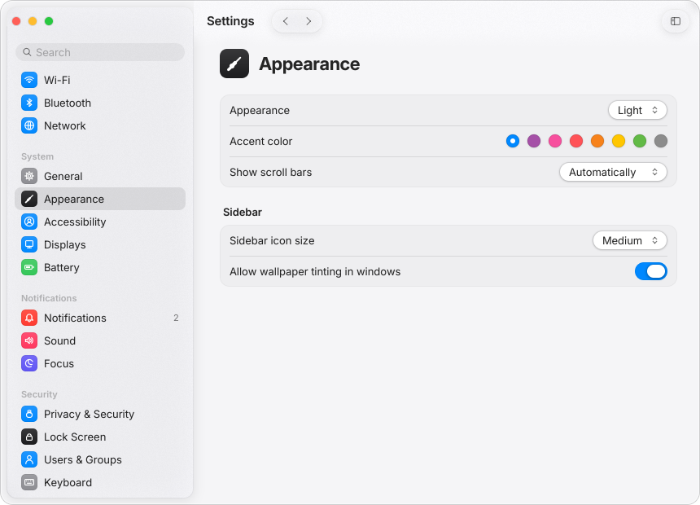

| Gallery (light) | Gallery (dark) |
|---|---|
| 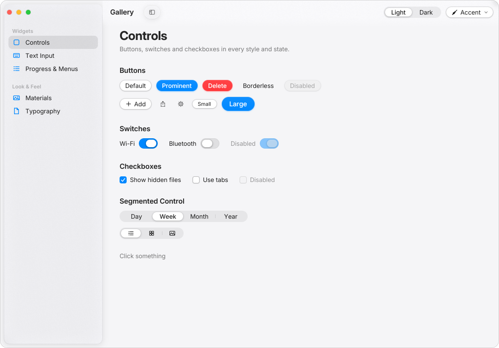 | 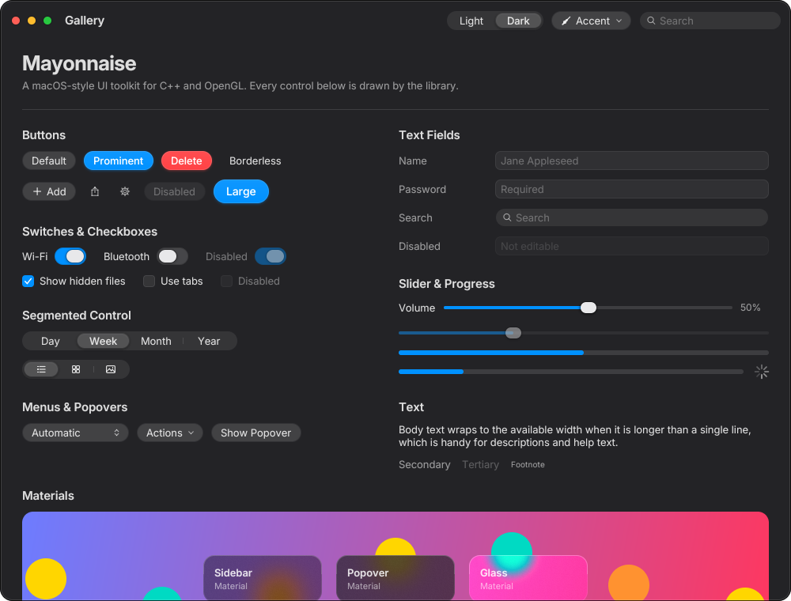 |
| **Menus over content** | **Content scrolling under the toolbar** |
| 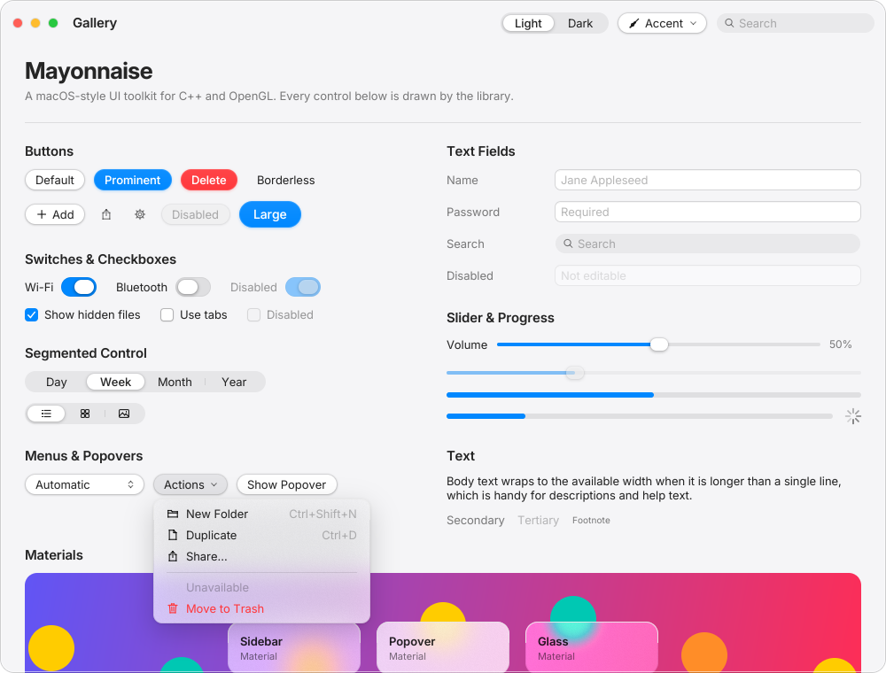 | 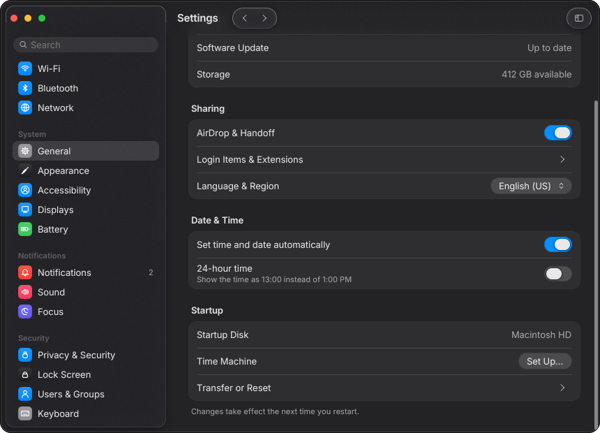 |

### Photos example

`examples/photos` is a small image library and viewer: import images or whole folders (toolbar,
Ctrl+O / Ctrl+Shift+O, drag & drop onto the window, or command-line arguments), browse a thumbnail grid
(pinch or Ctrl+scroll to resize), mark favourites, search by name, and open a photo to zoom and pan
(pinch, wheel, double-click for 100%, two-finger swipe or arrows for next/previous). Thumbnails are decoded
on worker threads; JPEG EXIF orientation is honoured.

```sh
./build/examples/photos/photos ~/Pictures
```

| Library | Viewer |
|---|---|
| 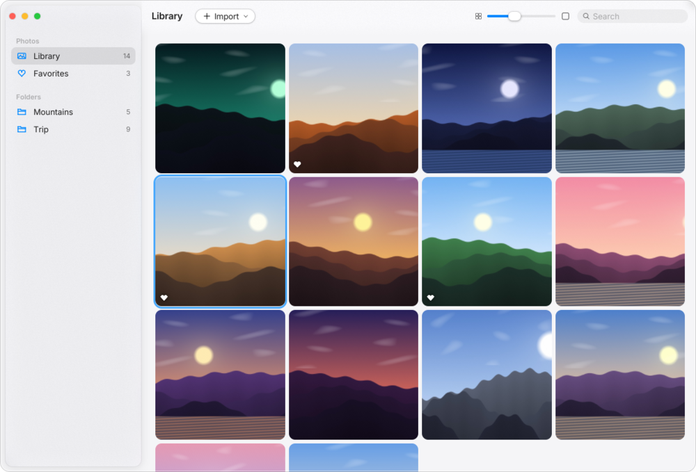 | 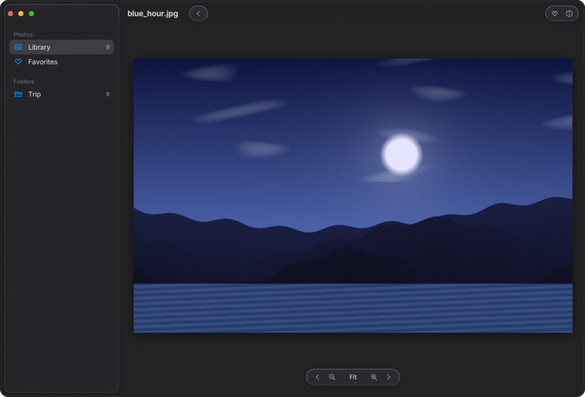 |

### Video player example

`examples/video_player` is a QuickTime-style player: the video runs under the title bar, a dark Liquid
Glass HUD floats at the bottom (play/pause, ±10 s, volume, loop, full screen, timeline with a time bubble)
and the controls and title bar fade away after a few idle seconds. Decoding uses FFmpeg on background
threads with audio as the master clock and frame-accurate seeking. Drop several files to queue them.

```sh
./build/examples/video_player/video_player movie.mp4
```

Keys: Space/K play-pause · ←/→ 5 s · J/L 10 s · ↑/↓ volume · M mute · F full screen · Ctrl+O open.

**Hardware decoding**: H.264, HEVC (incl. 10-bit), VP9 and AV1 decode on the GPU through VAAPI (AMD/Intel;
CUDA, Vulkan and VDPAU are tried next). On VAAPI the decoded surface is shared with OpenGL as a dma-buf
(zero-copy: the picture never visits system memory); YUV→RGB (BT.601/709/2020, limited/full range, 10-bit)
happens in the shader for every path, software decoding included. If the GPU can't handle a stream FFmpeg
falls back to software automatically; the ⓘ button in the HUD shows which path is in use.
`MAYO_HWDEC=auto|none|vaapi|cuda|vulkan|vdpau` and `MAYO_NO_ZEROCOPY=1` override the choice.
It needs FFmpeg's development packages (`libavformat-dev libavcodec-dev libswscale-dev libswresample-dev`
on Ubuntu, `ffmpeg-free-devel` on Fedora); without them CMake simply skips this example.

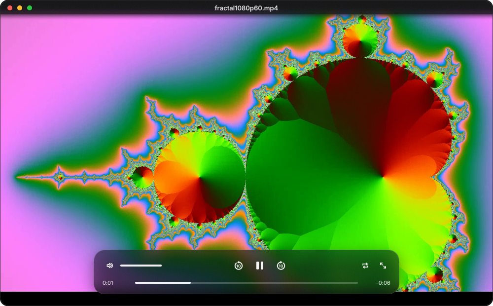

### Task manager example

`examples/task_manager` is an Activity Monitor-style system monitor for Linux: CPU, Memory, Disk and Network
tabs, each with live history graphs (CPU load stacked by user/system, per-core bars, memory pressure,
mirrored read/write and in/out graphs), volumes with capacity bars, network interfaces with addresses, and a
sortable, resizable, searchable process table (filters: all / mine / other users / active). Double-click a
process to inspect it; Quit (SIGTERM) and Force Quit (SIGKILL) ask for confirmation. Sampling runs on a
background thread every 1–5 s (View menu); the app itself uses well under 1 % CPU.

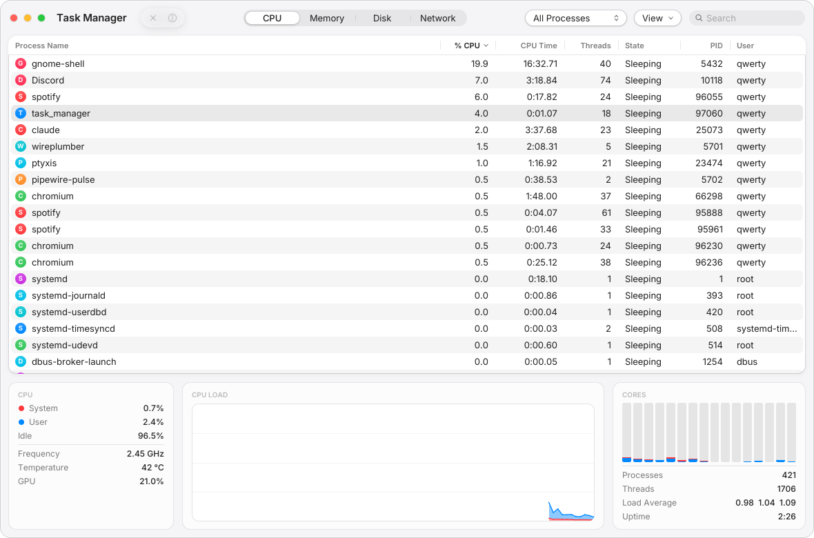

Per-process network traffic isn't available on Linux without root/eBPF, so the Network tab lists open
sockets per process; disk I/O per process is only readable for your own processes.

### Terminal example

`examples/terminal` is a terminal emulator in the style of macOS Terminal: xterm-256color with true colour,
the alternate screen, mouse reporting, bracketed paste and OSC titles / working directory / clipboard;
scrollback that re-wraps when the window is resized; tabs; selection (double-click words, triple-click
lines), Ctrl+click links, colour profiles (Basic follows light/dark, Pro, Homebrew, Ocean, Solarized) and the
system's monospace font with automatic fallbacks for CJK and symbols. Box drawing, block and braille
characters are drawn as geometry, so `btop` and friends look right.

```sh
./build/examples/terminal/terminal ~/Projects
```

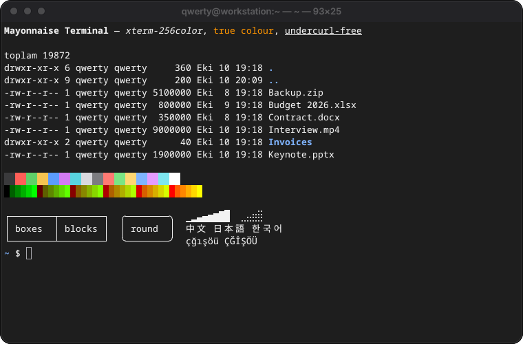

### Settings

Every app gets persistent preferences in `~/.config/mayonnaise/<app>/settings.conf` and follows the desktop's
light/dark mode and accent colour unless the user picks their own:

```cpp
mayo::App app("notes");                                   // settings go to ~/.config/mayonnaise/notes/
auto& window = app.createWindow({.title = "Notes", .autosaveName = "main"});  // remembers its size
bool wrap = app.settings().getBool("wrapLines", true);
app.settings().set("wrapLines", false);                   // saved shortly after, atomically
auto prefs = mayo::Form({mayo::AppearanceSettings(app)}); // Auto / Light / Dark + accent colour, live
```

All examples have a Settings window (Ctrl+,).

### Finder example

`examples/finder` is a file manager modelled on the macOS Finder: Icons, List (with disclosure triangles) and
Columns views (Ctrl+1/2/3) with a preview pane, picture thumbnails and text "page" previews decoded in the
background, Quick Look (Space), Get Info (Ctrl+I), inline rename (Enter), drag and drop between folders
(hold Ctrl to copy), copy / cut / paste, Duplicate, Move to Trash with Put Back and Undo (Ctrl+Z), recursive
search, Go to Folder (Ctrl+Shift+G), a path bar, Recents, and folders that update live (inotify). It uses
the freedesktop.org Trash, so items trashed here show up in other file managers too.

```sh
./build/examples/finder/finder ~/Documents
```

| Icons | Columns (dark) |
|---|---|
| 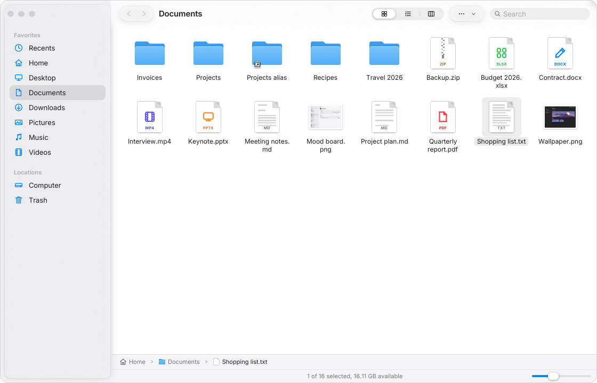 | 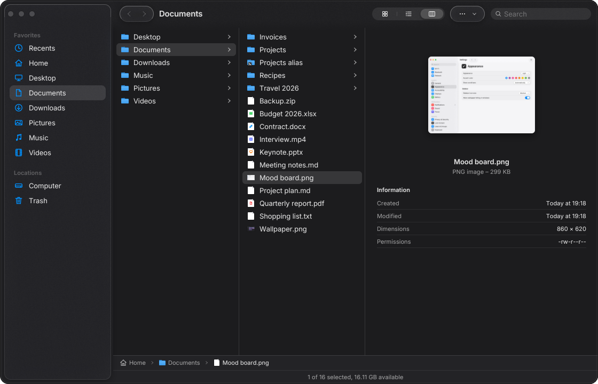 |

### System Settings example

`examples/system_settings` is a System Settings-style control centre for GNOME on GNU/Linux. It changes the
real desktop: every panel reads and writes the same GSettings keys and D-Bus services as GNOME Settings and
follows changes made elsewhere while it's open.

- **Wi-Fi / Network / Bluetooth** — NetworkManager (join, password prompt, hidden networks, forget,
  auto-join, details, airplane mode, wired, VPN import, proxy) and BlueZ (power, pair, connect, forget,
  battery levels).
- **Displays / Sound / Power** — Mutter's DisplayConfig (resolution, refresh rate, VRR, scale, orientation,
  primary display, with a 20-second "Keep these settings?" revert), backlight via logind, Night Light;
  PipeWire/PulseAudio via `pactl` (devices, ports, volume, balance, per-app volume); UPower battery state,
  health and peripherals, power-profiles-daemon modes, suspend and power-button behaviour.
- **Appearance / Multitasking / Notifications / Search / Apps** — light/dark, GNOME accent colours,
  wallpapers (thumbnails from GNOME's cache), fonts, themes, workspaces and window behaviour, per-app
  notifications, search providers and locations, default apps.
- **Mouse & Touchpad / Keyboard / Accessibility / Privacy / Wellbeing** — pointer and touchpad options,
  input sources, XKB options, a shortcut recorder and custom shortcuts, the accessibility switches, screen
  lock, location, camera/microphone, file history, screen-time limits and break reminders.
- **Region & Language / Date & Time / Users / About** — AccountsService and systemd's localed, timedated
  and hostnamed (language, formats, time zone search, NTP, account picture and name, device name, hardware).

```sh
./build/examples/system_settings/system_settings            # last panel
./build/examples/system_settings/system_settings bluetooth  # like gnome-control-center bluetooth
SETTINGS_READ_ONLY=1 ./build/examples/system_settings/system_settings   # look, never change anything
```

It needs GIO (`libglib2.0-dev` / `glib2-devel`) and is skipped without it. Missing services (no
power-profiles-daemon, no Bluetooth, another desktop's schemas) disable or hide the affected rows instead of
failing.

| Appearance (dark) | Displays (light) |
|---|---|
| 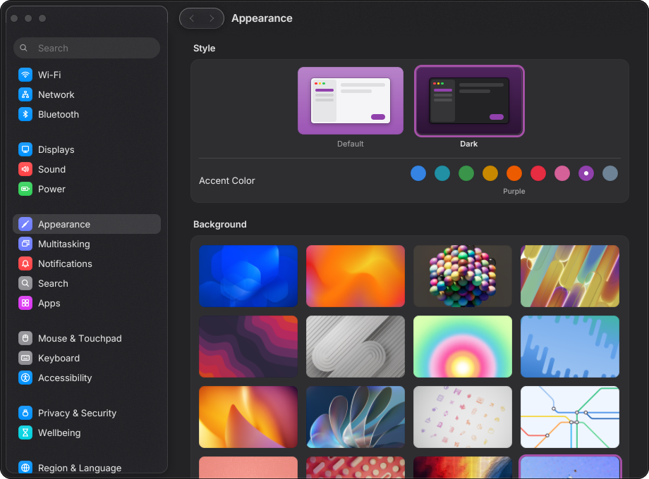 | 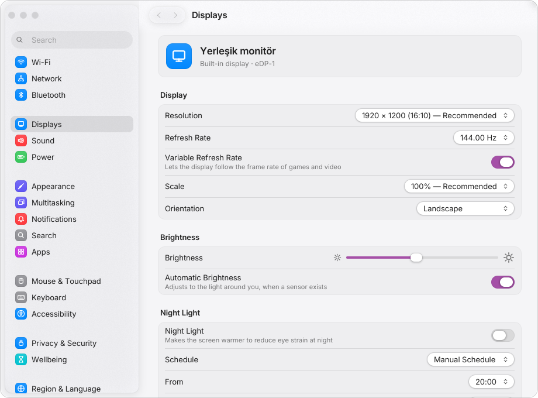 |

## Hello World

```cpp
#include <mayonnaise/mayonnaise.hpp>

int main() {
    mayo::App app;

    auto& window = app.createWindow({ .title = "Hello", .width = 800, .height = 520 });

    int count = 0;
    auto label = mayo::Label("Clicked 0 times").font(mayo::TextStyle::Title2);

    window.setContent(
        mayo::VStack({
            label,
            mayo::Button("Click me").style(mayo::ButtonStyle::Prominent)
                .onClick([&] { label.setText("Clicked " + std::to_string(++count) + " times"); }),
            mayo::Toggle("Dark mode").onChange([&](bool on) {
                app.setAppearance(on ? mayo::Appearance::Dark : mayo::Appearance::Light);
            }),
        }).spacing(12).padding(24).align(mayo::Alignment::Center)
    );

    return app.run();
}
```

## Features

- **Rendering**: one batched, instanced SDF renderer — anti-aliased rounded rects with per-corner radii,
  analytic Gaussian box shadows, gradients, lines/arcs, rounded clipping, and dual-Kawase backdrop blur for
  materials. Redraws only on demand (idle CPU ≈ 0) and only while animations run.
- **Text**: FreeType + embedded [Inter](https://rsms.me/inter/) variable font (weight and optical-size axes),
  ¼-pixel subpixel positioning, Inter's dynamic tracking, the macOS type scale
  (`LargeTitle … Caption`), word wrapping.
- **Window chrome**: client-side title bar with traffic lights, unified toolbar with glass button groups,
  compositor-driven dragging and resizing (works on Wayland), rounded transparent window corners.
- **Widgets**: `Label`, `Button` (Default / Prominent / Borderless / Destructive / Glass), `Toggle`,
  `Checkbox`, `Slider`, `TextField` (+ secure and search styles), `SegmentedControl`, `ProgressBar`
  (determinate / indeterminate / spinner), `Picker`, `Menu`, `Popover`, `Sidebar`, `SplitView`,
  `ScrollView` (wheel glide, touchpad momentum, rubber banding, overlay scrollbars), `Toolbar`,
  `Form` / `FormSection` / `FormRow`, `Image` (fit / fill / stretch), `Canvas`, and the `VStack` / `HStack` / `ZStack` / `Spacer` /
  `Divider` layout primitives.
- **Theming**: light/dark appearance, configurable accent colour, semantic colours
  (`label`, `secondaryLabel`, `separator`, `controlBackground`, …), all from one `mayo::Theme`.
- **States**: every control handles hover, pressed, keyboard focus (accent focus ring, Tab / Shift+Tab),
  and disabled, in both appearances.
- **HiDPI**: layout in points; follows the display scale (override with `MAYO_SCALE=2`).

## Building

Requirements: a C++20 compiler (GCC 12+ or Clang 15+), CMake ≥ 3.21, git, and the OpenGL / X11 / Wayland
development headers that SDL3 needs. SDL3, FreeType and doctest are taken from the system when present and
otherwise fetched and built automatically.

Ubuntu 24.04:

```sh
sudo apt install build-essential cmake git pkg-config \
  libgl1-mesa-dev libegl1-mesa-dev libx11-dev libxext-dev libxrandr-dev libxcursor-dev libxi-dev \
  libxss-dev libxtst-dev libxkbcommon-dev libwayland-dev wayland-protocols libdecor-0-dev libfreetype-dev
```

Fedora 40:

```sh
sudo dnf install gcc-c++ cmake git pkgconf-pkg-config \
  mesa-libGL-devel mesa-libEGL-devel libX11-devel libXext-devel libXrandr-devel libXcursor-devel \
  libXi-devel libXScrnSaver-devel libXtst-devel libxkbcommon-devel wayland-devel wayland-protocols-devel \
  libdecor-devel freetype-devel
```

Then:

```sh
cmake -B build -DCMAKE_BUILD_TYPE=Release && cmake --build build -j
./build/examples/hello/hello
./build/examples/gallery/gallery
./build/examples/settings_app/settings_app
ctest --test-dir build --output-on-failure
```

| CMake option | Default | |
|---|---|---|
| `MAYONNAISE_BUILD_EXAMPLES` | `ON` (top level) | build `examples/` |
| `MAYONNAISE_BUILD_TESTS` | `ON` (top level) | build the doctest suite |
| `MAYONNAISE_USE_SYSTEM_DEPS` | `OFF` | require system SDL3 / FreeType / doctest instead of falling back to fetching |
| `MAYONNAISE_SANITIZE` | `OFF` | AddressSanitizer + UndefinedBehaviorSanitizer |

## Using it in your project

```cmake
include(FetchContent)
FetchContent_Declare(mayonnaise GIT_REPOSITORY <url-of-this-repo> GIT_TAG main)
FetchContent_MakeAvailable(mayonnaise)        # or: add_subdirectory(mayonnaise)

target_link_libraries(app PRIVATE mayonnaise::mayonnaise)
```

When SDL3 and FreeType come from the system, `cmake --install build` also installs a package config, so
`find_package(mayonnaise)` works.

Public headers never include SDL, OpenGL, or FreeType, so your code only sees `<mayonnaise/...>`.

## API in five minutes

Widgets are cheap handles to shared nodes: copy them, capture them in lambdas, mutate them later.
Modifiers chain and return the widget:

```cpp
auto name = mayo::TextField("Name").onSubmit([](const std::string& s) { /* ... */ });
auto save = mayo::Button("Save").style(mayo::ButtonStyle::Prominent).disabled();
name.onChange([save](const std::string& s) mutable { save.setDisabled(s.empty()); });

mayo::HStack({ name, save }).spacing(8).padding(12)
    .background(mayo::Material::Glass).cornerRadius(14);
```

- Layout: stacks measure their children, then share free space among expanding children (`Spacer`,
  `TextField`, `Slider`, `.fillWidth()`, `.flex(2)`). `.frame(w, h)`, `.width()`, `.minWidth()`,
  `.maxWidth()`, `.padding()` constrain any widget. Stacks default to top-leading alignment.
- Common modifiers: `.padding()`, `.frame()`, `.foreground()`, `.background(Color | Material)`,
  `.cornerRadius()`, `.disabled()`, `.hidden()`, `.opacity()`, `.tooltip()`.
- App: `app.setAppearance()`, `app.setAccentColor()`, `app.after(seconds, fn)`, `app.post(fn)` (thread-safe),
  `app.openFiles(filters, multiple, done)` / `app.openFolder(done)` (native dialogs via the xdg portal).
- Window: `setContent()`, `setToolbar(mayo::Toolbar({...}))`, `setTitle()`, `onFilesDropped(fn)`,
  `onKey(fn)` for app-wide shortcuts.
- Images: `mayo::ImageData::load(path, maxDimension)` decodes off the UI thread (PNG, JPEG with EXIF
  orientation, GIF, BMP, TGA); `mayo::Image(data).contentMode(ContentMode::Fill)` displays it.
- Touchpad pinch arrives as `Widget::onMagnify(const MagnifyEvent&)`.
- Media: `mayo::VideoTexture` holds YUV frames (I420, NV12, P010 uploads or zero-copy dma-buf imports) and
  `Painter::drawVideo()` converts them on the GPU; `mayo::AudioOutput` streams float PCM to the default device (thread-safe writes);
  `ImageData::create(w, h)` + `update(pixels)` for frames that change every vsync;
  `window.setFullscreen()`, `window.setChromeHidden()` (fades the title bar); `Painter::fillTriangle()`.
- Custom drawing: `mayo::Canvas([](mayo::Painter& p, mayo::Rect r) { p.fillCircle(r.center(), 8, c); })`.
- Custom widgets: subclass `mayo::Widget` (override `measureContent`, `arrangeContent`, `draw`, and the
  `onPointer…` / `onKey…` handlers), then use it with `mayo::Custom<MyWidget>(args...)` to get the
  modifier API. See `include/mayonnaise/widget.hpp`.

## Environment variables

| Variable | Effect |
|---|---|
| `MAYO_APPEARANCE=dark\|light` | appearance at startup |
| `MAYO_SCALE=2` | override the UI scale (HiDPI testing) |
| `MAYO_NO_TRANSPARENCY=1` | opaque, square windows (X11 without a compositor) |
| `MAYO_SCREENSHOT=out.png` | render, save the window as PNG and exit (`MAYO_SCREENSHOT_FRAMES`, `MAYO_SCREENSHOT_DELAY`) |
| `MAYO_VERBOSE=1` | print the GL version/renderer and whether KHR_debug output is active |
| `SDL_VIDEO_DRIVER=x11\|wayland` | choose the SDL backend |

## Status and limitations

This is an MVP. Known gaps: no kerning or complex shaping (HarfBuzz is a natural next step), no
accessibility APIs, IME composition preview is minimal, single-line text fields only, no client-side window
shadow (the compositor doesn't draw one for borderless windows), and only Linux is implemented — platform
code is isolated in `src/platform/` for future macOS/Windows backends.

## Licensing notes

Mayonnaise evokes the macOS design language but ships no Apple assets: text uses Inter (SIL Open Font
License, see `assets/fonts/Inter-LICENSE.txt`) and all icons are drawn from vector primitives in
`src/widgets/icons.cpp`. Vendored: glad (generated, MIT/Apache-2.0 headers), stb_image /
stb_image_write (public domain).
